# AI 出境游规划助手

一个用 AI 帮自由行用户规划出境旅行的应用，包含两部分：

| 部分 | 内容 | 状态 |
|---|---|---|
| [`demo/`](demo/) | **闺蜜旅行搭子**：基于 LangGraph 多智能体的旅行规划 Web 应用（Streamlit） | 可运行，持续迭代约 20 个版本 |
| [`next-version/`](next-version/) | **移动端重新设计**：面向中国大陆用户的下一版，从竞品实测、流程拆解、技术验证到高保真原型 | 设计与技术验证阶段，开发进行中 |

---

## 一、可运行的 demo：闺蜜旅行搭子

输入目的地、天数和偏好，由多个 AI 角色协作生成一份完整的旅行攻略：每日行程、地图、餐厅推荐、城市导览，生成后可以直接用自然语言修改。

### AI 架构

用 LangGraph 编排多个智能体，新建行程和修改行程走两条不同的路径：

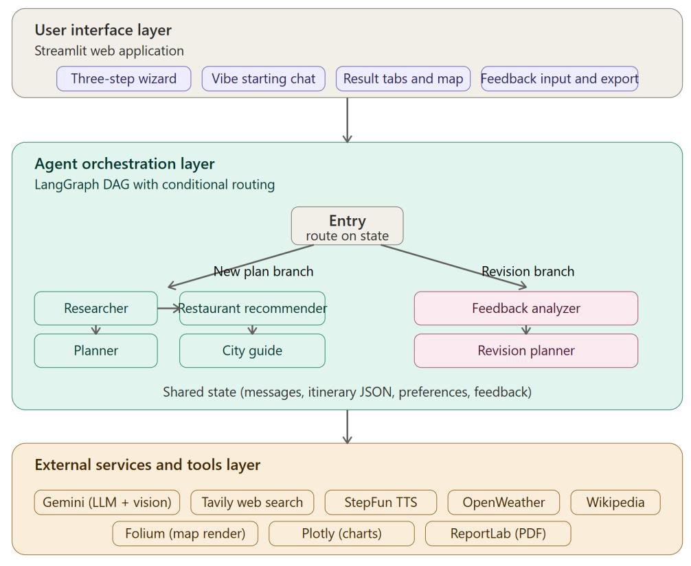

智能体流程：

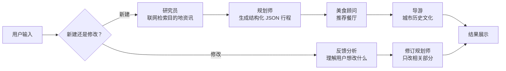

| 能力 | 实现 |
|---|---|
| 多智能体编排 | LangGraph `StateGraph`，条件路由区分"新建 / 修改"，`MemorySaver` 保留会话状态 |
| 模型分工 | 主任务（研究、规划、修改）用 `gemini-2.5-flash`；辅助任务（地图、聊天、照片识别）用 `gemini-2.5-flash-lite`，兼顾质量与成本 |
| 工具调用 | 研究员通过 Tavily 联网检索；OpenWeather 天气；Wikipedia / Wikimedia Commons 获取景点介绍和照片 |
| 结构化输出 | 规划师输出 JSON，前端直接渲染为每日卡片和地图，不靠正则解析长文本 |
| 多模态 | 上传照片，由视觉模型识别其中的景点 |
| 内容校验 | 粘贴小红书帖子，AI 抽取其中可核实的说法，再与外部资料交叉比对，判断是否夸大 |
| 其他 | 对话式旅行助手、"Vibe Starting"对话式开始、语音导览（StepFun TTS）、预算图与时间线、导出 PDF / ICS / Markdown |

### 截图

**生成结果**：每日行程卡片 + 多城市地图，底部可直接输入修改意见

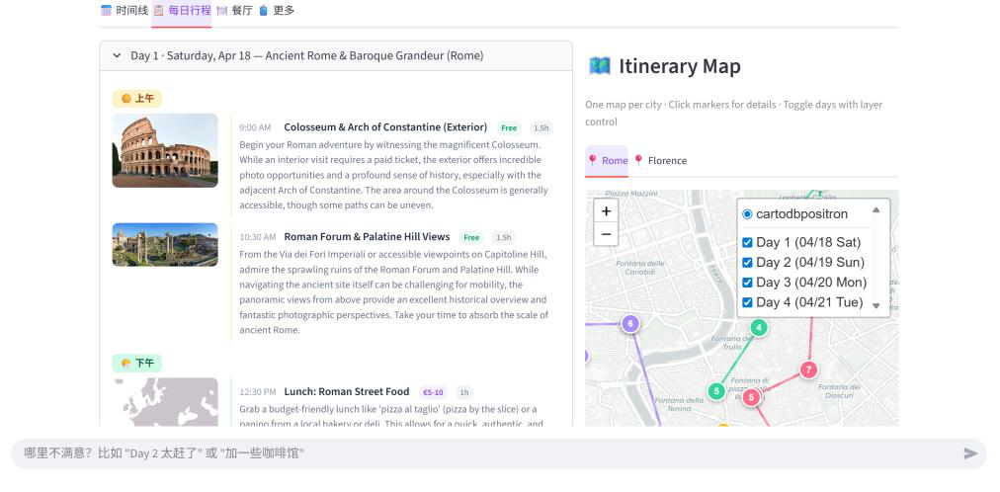

| 每日行程卡片 | 多城市地图（按天配色） |
|---|---|
| 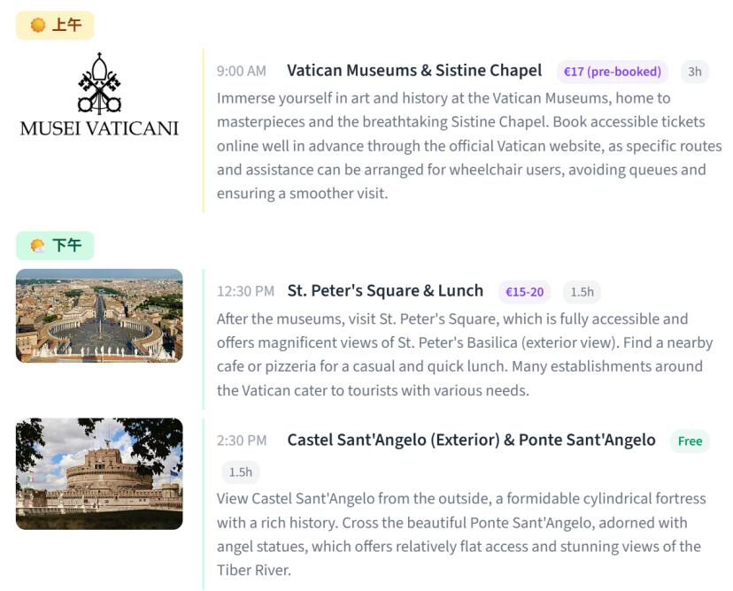 | 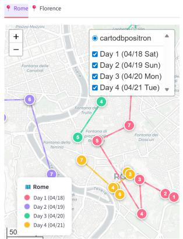 |

| 照片识别景点并加入行程 | 小红书内容校验报告 |
|---|---|
| 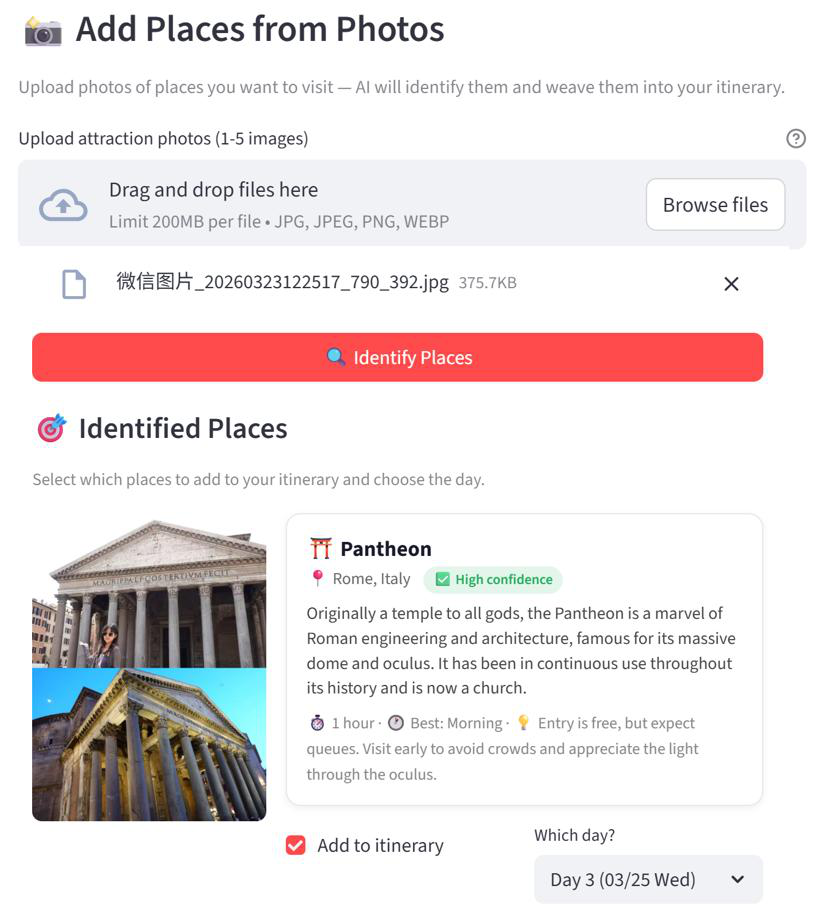 | 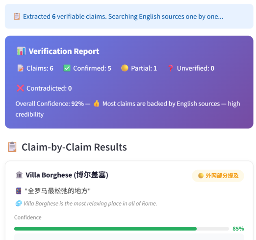 |

| 时间线 | 按城市分组的餐厅推荐 |
|---|---|
| 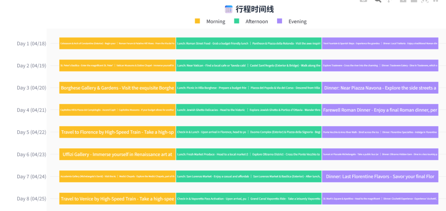 | 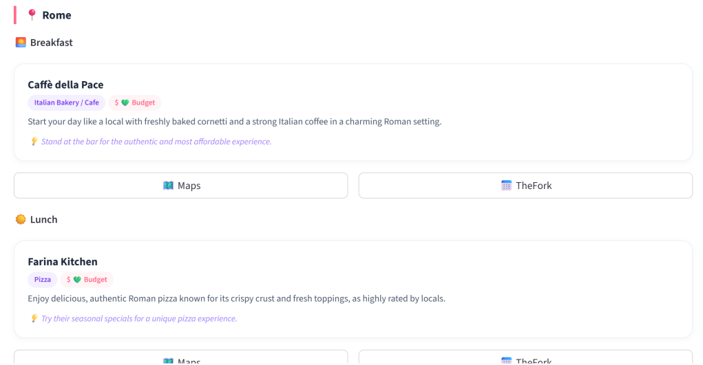 |

**输入流程**：三步表单，偏好可跳过

| 填写行程 | 偏好 | 确认并生成 |
|---|---|---|
| 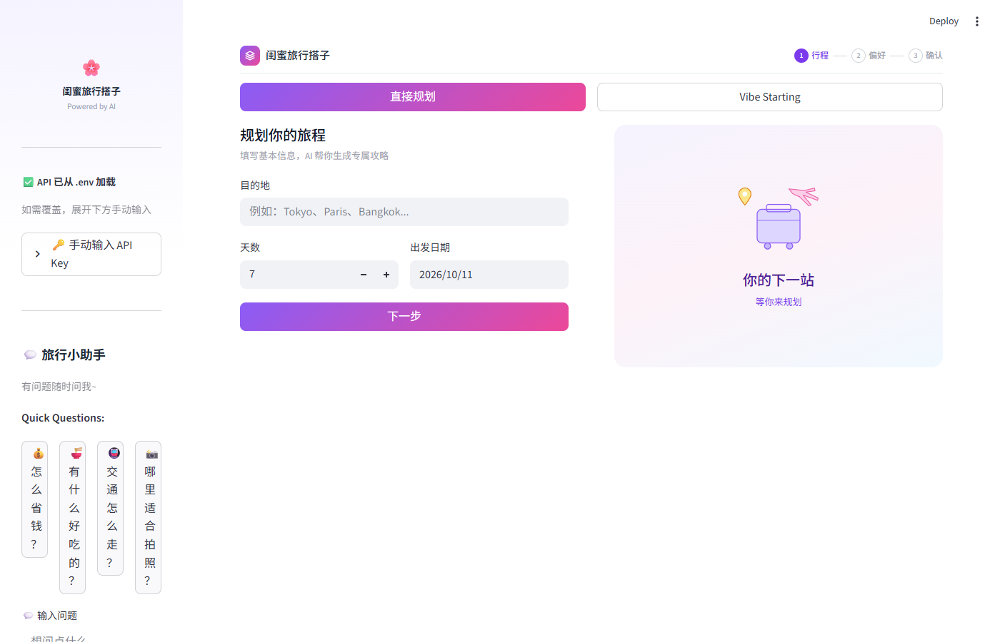 | 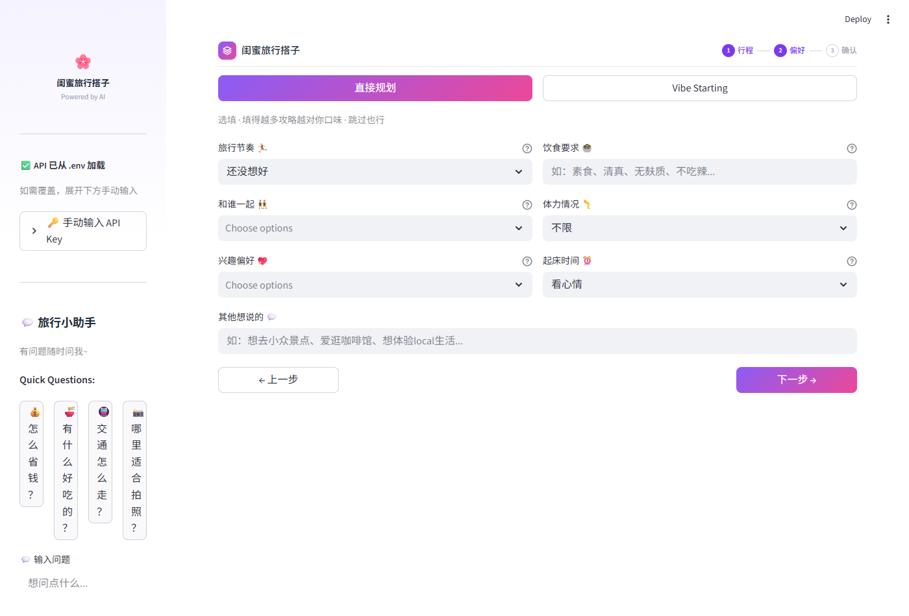 | 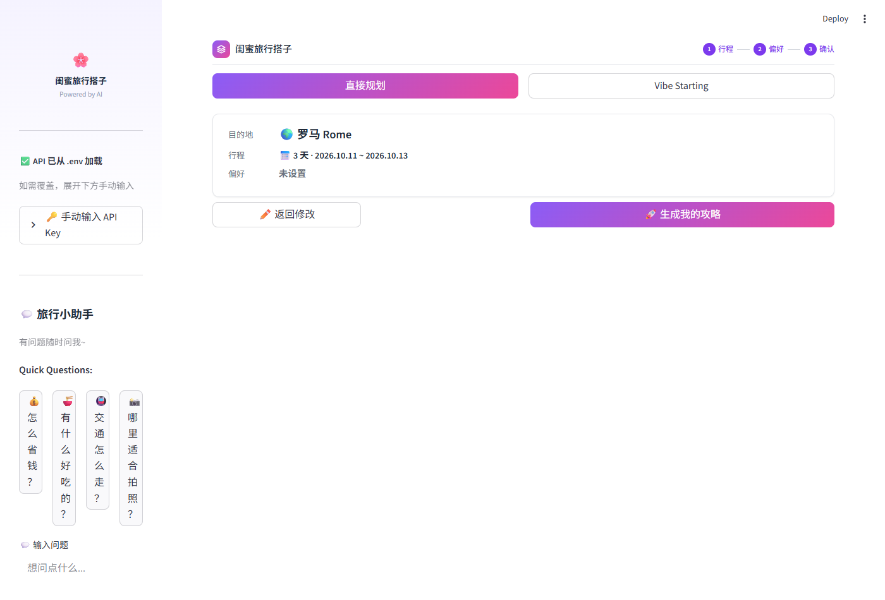 |

### 运行

```bash
cd demo
pip install -r requirements.txt          # Python 3.10 测试通过
cp .env.example .env                     # 填入自己的 key
streamlit run travel_plan_agent18.py
```

需要的 key：`GEMINI_API_KEY`（必需）、`TAVILY_API_KEY`（联网检索）、`OPENWEATHER_API_KEY`（天气）、`STEPFUN_API_KEY`（语音导览，可选）。也可以在页面侧边栏手动输入。

---

## 二、下一版：移动端重新设计

### 为什么做下一版

在 demo 的基础上，下一版瞄准三个方向：

1. **面向中国大陆用户**：全部采用大陆可访问的模型、地图与数据方案。
2. **移动端优先**：旅行规划主要发生在手机上，交互按手机重新设计。
3. **更准、更快、更省**：把事实数据、路线计算与 AI 的判断分开，提升结果的准确度和生成速度。

于是按完整的产品流程重新设计，而不是在原有界面上修补。

### 过程

| 阶段 | 产出（在 `next-version/` 中，浏览器直接打开） |
|---|---|
| 竞品实测 | 实测 8 款产品（ChatGPT、豆包、携程、同程、飞猪、马蜂窝、圆周旅迹、Mindtrip），提炼设计取舍 |
| 流程拆解 | `产品流程拆解.html`：输入 → AI 生成 → 查看 → 调整 → 导出 |
| 首版范围 | `首版范围与页面职责.html`：7 个页面的职责与关键状态 |
| 低保真原型 | `低保真原型.html`：可点击，跑通完整案例；开发中用 29 项自动化检查验证交互逻辑 |
| 技术可行性验证 | `技术可行性验证.html`：大陆可用的技术方案，地图、路线、地点、天气均已实测 |
| 视觉设计 | 三个方向对比 → 选定"清新杂志感" → 可读性优化 → 4 套配色 × 4 个目的地交叉验证（`高保真-跨目的地验证.html`） |
| 高保真原型 | `高保真原型.html`：7 个页面、19 个画面，含空状态、生成失败、AI 修改待确认与撤回等 |
| 设计规范 | `设计规范.html`：颜色（含对比度）、状态色、字体、组件、地图与主题规则 |

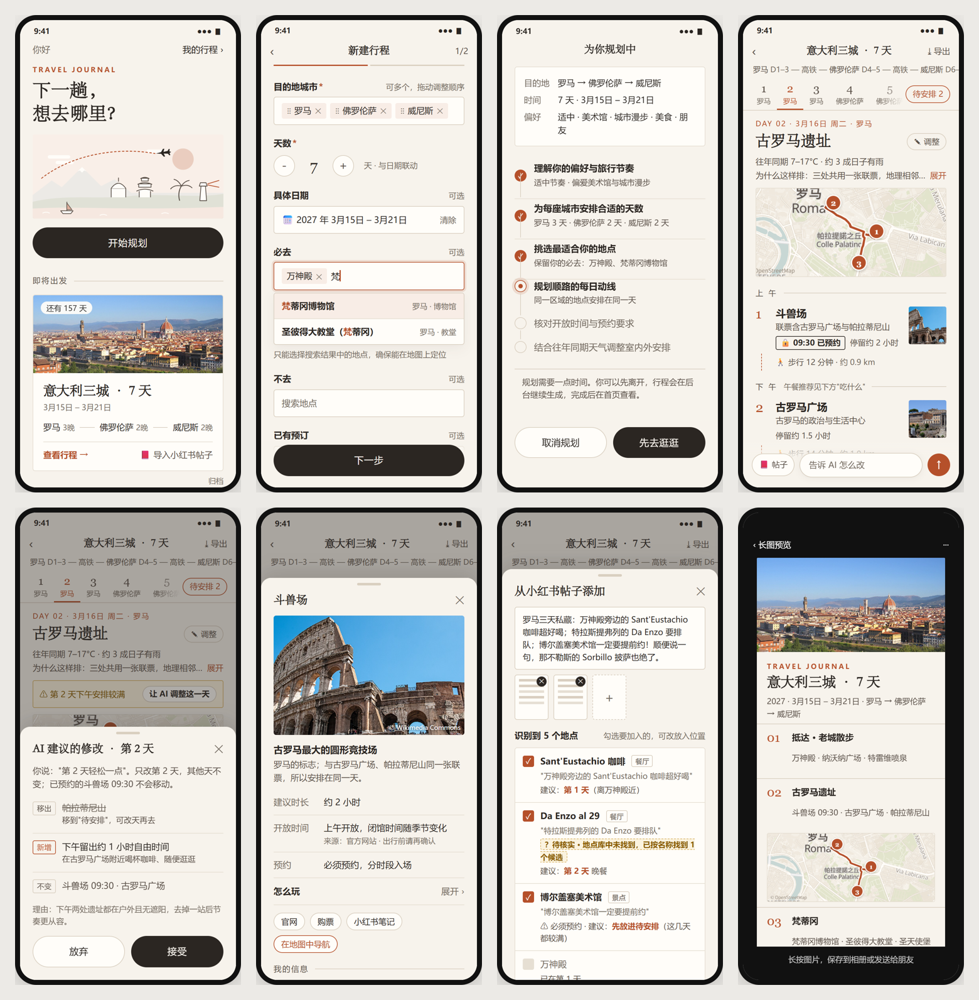

### 关键设计决策

- **AI、数据、程序分工**：AI 负责理解偏好和取舍；地点坐标、开放时间来自地点库并注明来源；路线耗时和"能否赶上预约"由程序计算校验，不让模型"自称已检查"。
- **AI 修改先预览再确认**：用户说"第 2 天轻松一点"，AI 只改那一天，列出"移出 / 新增 / 不变"，接受后可撤回；已预约项目不会被移动。
- **信息可信度可见**：区分"已预约""待核实""时间冲突"，未知的营业时间显示为未知，不让 AI 补成确定事实。
- **大陆可用**：自托管 OpenStreetMap 底图（罗马城区仅 12 MB）、国内大模型、后端代理海外数据；照片不加滤镜，地图为真实底图 + 实测路线。
- **小红书导入**：粘贴文字或截图，识别地点后逐项给出建议放在哪天，自动排除重复和不在行程城市的地点。

### 进展

产品设计、视觉规范与关键技术验证已完成，原型以示例行程展示完整交互。正在接入国内大模型，按上述分工打通"创建 → 生成 → 修改 → 保存"主流程。

---

## 三、AI 工具在开发中的使用

整个项目以 AI 编程工具为主要协作者完成：

- **Claude Code**：编写 demo 代码与原型；用无头浏览器自动截图、跑原型检查；做技术验证（切地图、调路线和天气接口）；整理产品文档。
- **Codex**：独立审阅文档与技术方案，对结论的证据和严谨性把关。
- **我的角色**：定方向与取舍、亲自实测竞品、判断哪些审阅意见成立、做最终的设计决策。

两个工具交叉审阅，是这个项目里控制 AI 产出质量的主要方法。

---

## 素材与许可

- 照片：Wikimedia Commons（可商用许可），作者与许可见 `next-version/assets/photos/credits.json`。
- 地图：© OpenStreetMap 贡献者（ODbL），底图来自 Protomaps。
- 天气：Open-Meteo 历史天气数据。
